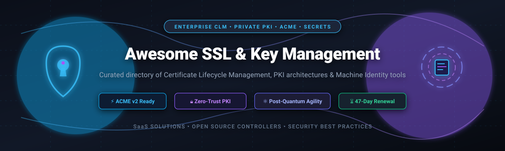

# 🔐 Awesome SSL Certificate & Security Key Management 🔑

**🚀 A comprehensive, curated directory of the best SSL/TLS Certificate Lifecycle Management (CLM), Public Key Infrastructure (PKI), and Cryptographic Key & Secret Management solutions.**

*🛡️ Master automated issuance, ACME protocol operations, short-lived 47-day certificate renewals, post-quantum crypto agility, and private key security.*

[📈 Sector Overview](#-sector-overview--market-dynamics) • [🟦 SaaS Platforms](#-saas--hosted-platforms) • [🟩 Open-Source PKI](#-open-source-software) • [📊 Comparison](#-comparison-at-a-glance) • [🏛️ Archetypes](#️-key-architectural-archetypes) • [⭐ Star History](#-star-history) • [💖 Support](#-support) • [🤝 Contributing](#-contributing)

---

## 📑 Table of Contents

- [📈 Sector Overview & Market Dynamics](#-sector-overview--market-dynamics)
- [🟦 SaaS / Hosted Platforms](#-saas--hosted-platforms)
  - [🏢 Enterprise SaaS Comparison Table](#enterprise-saas-comparison-table)
  - [🔍 Platform Deep Dives](#platform-deep-dives)
- [🟩 Open-Source Software](#-open-source-software)
  - [⭐ Popular Open-Source Solutions (by Stars)](#popular-open-source-solutions-by-stars)
  - [🛠️ Tool Deep Dives](#tool-deep-dives)
- [📊 Comparison at a Glance](#-comparison-at-a-glance)
- [🏛️ Key Architectural Archetypes](#️-key-architectural-archetypes)
- [⭐ Star History](#-star-history)
- [💖 Support](#-support)
- [🤝 Contributing](#-contributing)
- [📄 License](#-license)

---

## 📈 Sector Overview & Market Dynamics

The global **Certificate Lifecycle Management (CLM)** and Machine Identity Management sector is currently estimated at **$1.5 billion to $1.8 billion** 🌐 and is projected to expand at a rapid **17% to 20% CAGR** 📊, crossing **$4.5 billion to $6.5 billion** over the next decade.

The sector demonstrates a **moderately fragmented yet bifurcated structure**:
- 🏢 **Enterprise Multi-Cloud CLM Core:** Established cybersecurity and Certificate Authority (CA) leaders (*DigiCert, Sectigo, CyberArk/Venafi, Keyfactor, AppViewX*) command large-scale enterprise machine identity deployments, audit governance, and hybrid private PKI integrations.
- 🧩 **Fragmented Cloud-Native & Developer Edges:** Accelerating operational shifts—such as browser-driven compression of public SSL/TLS validity down to **47 days** ⏳, zero-trust microservice networking 🛡️, ephemeral Kubernetes workloads ☸️, and mandatory Post-Quantum Cryptography (PQC) algorithm migration ⚛️—fuel continuous adoption of hyper-scaler native services (*AWS ACM, Cloudflare*) ☁️ alongside modern open-source ACME controllers and zero-trust micro-CAs.

---

## 🟦 SaaS / Hosted Platforms

Commercial, cloud-hosted SSL/TLS Certificate and Security Key Management platforms offering automated certificate lifecycle management (CLM), network discovery, policy compliance, and crypto agility.

### 🏢 Enterprise SaaS Comparison Table

Sorted descending by company size (Valuation / Revenue):

| 🏢 Platform | 💰 Company Valuation / Revenue | 🏷️ Starting Price | 🎁 Free Tier / Free Trial Limit | 🎯 Key Focus & Strengths |
|:---|:---|:---|:---|:---|
| **[AWS Certificate Manager (ACM)](https://aws.amazon.com/certificate-manager/)** ☁️ | **~$108B+ Rev** (AWS segment) / $2.0T+ Parent Cap | **$0.00** for public certs on AWS resources; Exportable public certs: $0.75/cert/mo; Private CA: $400/CA/mo | **Free forever** for public SSL/TLS certs deployed to integrated AWS services (ALB, CloudFront, API Gateway); Private CA has 30-day free trial (1 CA + issuance) 🆓 | Turnkey managed provisioning & zero-touch automatic renewals across AWS ecosystem |
| **[Cloudflare SSL/TLS](https://www.cloudflare.com/ssl/)** 🛡️ | **~$60B–$90B+ Market Cap** / ~$1.43B+ Annual Rev | **$10/zone/month** for Advanced Certificate Manager (Universal SSL free with all plans; Business: $200/mo) | **Free forever** Universal SSL tier (unlimited automated edge DV SSL certs on all Free Cloudflare domains) 🆓 | Edge SSL termination, automated origin CA certs, and programmable TLS cipher suites |
| **[DigiCert CertCentral](https://www.digicert.com/certcentral)** 🏛️ | **~$8B Valuation** / ~$1B+ Annual Rev | **$288/year** (~$24/month billed annually) for single standard domain protection package | **No free tier**; Interactive self-guided demo center available; enterprise PoC sandbox provided on request via Sales; 30-day trials available for specific DigiCert ONE modules | Enterprise CLM, full-network discovery scans, multi-format export, and deep enterprise PKI |
| **[BrowserStack Certificate Management](https://www.browserstack.com/)** 📱 | **~$4B Valuation** / ~$225M–$230M ARR | **$29/user/month** (billed annually) for App Live; Certificate injection requires custom Enterprise plan | **30 minutes free trial** for manual mobile/web testing; 100 minutes automated testing; Percy visual testing free tier up to 5,000 screenshots/mo | Real-device test environment SSL certificate injection & client-cert auth testing |
| **[Venafi TLS Protect](https://venafi.com/)** *(CyberArk)* 🔐 | **~$1.54B Acquisition Valuation** / ~$150M ARR | **~$50,000/year** baseline entry contract (scales based on machine identity volume; avg. $75K–$250K/yr) | **No free tier**; Custom enterprise guided proof-of-concept (PoC) available upon scoping with CyberArk sales | Large-scale enterprise machine identity management, FIPS 140-2 Level 3 HSM integration & ACME v2 |
| **[Keyfactor Command](https://www.keyfactor.com/products/command/)** 🔑 | **~$1.3B Valuation** / ~$200M ARR | **~$75,000/year** baseline enterprise contract (scales by certificate volume, typically 10K+ certs) | **No free tier**; Guided enterprise trial sandbox & interactive demo environment provided via Sales | Unified CLM with deep native EJBCA integration, risk intelligence dashboards, and PQC migration readiness |
| **[Entrust Certificate Services](https://www.entrust.com/digital-security/certificate-solutions)** 📜 | **~$916M+ Annual Rev** (Private Corp) | **~$199/year** for Standard SSL single-domain certificate (managed platform custom per endpoint volume) | **No free tier**; Dedicated enterprise trial evaluation accounts arranged via Entrust sales engineers | Public/private enterprise CA services, compliance auditing, and unified certificate management |
| **[Sectigo Certificate Manager](https://www.sectigo.com/enterprise-solutions/certificate-manager)** 🔒 | **~$150M+ Annual Rev** / PE-backed | **~$450/year** for entry-level managed certificate packages (custom quote for multi-CA enterprise tier) | **30-day free trial** of Sectigo Certificate Manager platform (up to 50 certificates discovery & test issuance) | Cloud-native, CA-agnostic CLM across hybrid IT, automated discovery agents, and ACME enrollment |
| **[GlobalSign Managed SSL](https://www.globalsign.com/en/managed-ssl)** 🌐 | **~$130M–$140M Annual Rev** (GMO GlobalSign) | **~$250/year** list baseline per cert (discounted to ~$70–$130/yr in multi-cert enterprise pools) | **No free tier**; Enterprise Managed PKI (MPO) demo test account issued for evaluation upon sales consultation | High-volume SAN licensing, pre-vetted domains for instant certificate issuance, and AD integration |
| **[AppViewX CERT+](https://www.appviewx.com/products/cert-plus/)** ⚙️ | **~$65M–$70M Annual Rev** / PE-backed | **~$15,000/year** entry-level SaaS subscription (scales with managed device and certificate counts) | **30-day free trial** on AppViewX AVX ONE SaaS platform (full access sandbox for certificate discovery & automation) | Multi-CA & multi-cloud orchestration, automated rotation, Terraform provider & compliance analytics |

---

### 🔍 Platform Deep Dives

#### DigiCert CertCentral
- **Type:** Enterprise certificate lifecycle management with active network discovery 🔎.
- **Overview:** Mature, enterprise-focused CLM platform providing centralized visibility and control over entire certificate inventories. Its Discovery tool scans networks to identify shadow and rogue certificates from other CAs, eliminating untracked spreadsheets. Automated lifecycle workflows via ACME and REST APIs enable issuance, renewal, and installation on servers and load balancers.
- **Best for:** Large organizations requiring multi-environment discovery and governance across on-prem and cloud infrastructure.

#### Sectigo Certificate Manager (SCM)
- **Type:** Cloud-native, CA-agnostic CLM ☁️.
- **Overview:** SCM is a CA-agnostic platform managing certificates from multiple CAs in a single console. Features progressive crypto agility models, native DevOps CI/CD integrations, and cloud connectors. Discovery and installation utilize agent-based architectures across Windows and Linux environments.
- **Best for:** Enterprises seeking vendor-neutral certificate lifecycle governance as TLS validity lifespans shrink.

#### Venafi TLS Protect (CyberArk)
- **Type:** Enterprise machine identity governance 🛡️.
- **Overview:** Venafi TLS Protect governs enterprise machine identities across complex global architectures. Supports ACME v2 clients, SCEP enrollment for network infrastructure, and integrations with Amazon Private CA and Microsoft Active Directory Certificate Services (ADCS). Features FIPS 140-2 Level 3 HSM support via Securosys Primus and AWS CloudHSM.
- **Best for:** Global enterprises requiring strict policy enforcement, automated auditing, and HSM-backed machine identity security.

#### Keyfactor Command
- **Type:** CLM with deep EJBCA integration and risk intelligence 📊.
- **Overview:** Integrates directly with EJBCA, allowing administrators to author and edit certificate profiles natively in the Command console. Features a dedicated Risk Intelligence dashboard, analytics widgets tracking weekly certificate velocity, and early support for NIST post-quantum cryptographic standards (e.g., SLH-DSA).
- **Best for:** Teams operating EJBCA or hybrid PKIs requiring crypto-agility insights and automated governance.

#### AppViewX CERT+
- **Type:** Multi-CA and multi-cloud certificate orchestration 🔄.
- **Overview:** Discovers, monitors, and orchestrates certificate lifecycles across external CAs (DigiCert, Entrust, EJBCA, AWS Private CA) and public clouds (AWS, Azure, GCP). Includes automated credential rotation, CAA/CT/CRL compliance monitors, and a certified Terraform provider for GitOps/IaC workflows.
- **Best for:** DevOps and SecOps teams orchestrating multi-cloud environments via infrastructure-as-code.

#### GlobalSign Managed SSL
- **Type:** Managed SaaS PKI & certificate issuance 🌐.
- **Overview:** Provides centralized discovery, lifecycle analysis, and high-velocity certificate issuance. Domains are pre-vetted for zero-delay issuance, with SAN pool licensing to accommodate dynamic container and server inventories. Supports ACME, REST APIs, and Active Directory auto-enrollment.
- **Best for:** Organizations wanting a managed CA service with pre-vetted domain portfolios.

#### Entrust Certificate Services (ECS)
- **Type:** Enterprise PKI and certificate lifecycle management 📜.
- **Overview:** End-to-end digital security platform providing public TLS/SSL, private PKI, and centralized lifecycle governance. Features deep enterprise reporting and automated issuance workflows for high-assurance environments.
- **Best for:** Enterprises needing combined public trust and high-compliance private enterprise PKI.

#### AWS Certificate Manager (ACM)
- **Type:** Cloud-native managed certificate provisioning ☁️.
- **Overview:** Handles provisioning, storage, and renewal of public and private SSL/TLS certificates across AWS services (ALB, CloudFront, API Gateway). Features zero-touch auto-renewal and wildcard domain protection at no additional fee for public endpoints.
- **Best for:** Cloud-native workloads running primarily within the AWS cloud ecosystem.

#### Cloudflare SSL/TLS
- **Type:** Edge certificate orchestration & CDN encryption ⚡.
- **Overview:** Provisions and manages edge SSL certificates automatically across millions of domains via Universal SSL. The Advanced Certificate Manager provides custom multi-SAN configurations, selectable Certificate Authorities (Let's Encrypt, Google Trust Services), and granular TLS cipher suite selection.
- **Best for:** Instant edge HTTPS termination and zero-maintenance edge SSL.

#### BrowserStack Certificate Management
- **Type:** Test-environment certificate injection for mobile and web apps 📱.
- **Overview:** Allows QA and engineering teams to upload and inject trusted custom `.cer` and `.mobileconfig` certificates into real iOS and Android physical test devices. Enables end-to-end testing of mobile apps utilizing SSL pinning or custom self-signed test environments without modifying source code.
- **Best for:** Mobile and web testing teams verifying SSL pinning and mutual TLS (mTLS) client authentication.

---

## 🟩 Open-Source Software

Self-hosted, community-driven SSL/TLS Certificate and Key Management tools. Open source solutions range from **lightweight ACME clients** and **Kubernetes certificate controllers** to **enterprise private CAs** and **integrated secrets/KMS platforms**.

### ⭐ Popular Open-Source Solutions (by Stars)

Sorted descending by GitHub stars:

| 📦 Repository | ⭐ GitHub Stars Badge | 💻 Tech Stack | 📜 License | 🏷️ Category | 🎯 Primary Focus |
|:---|:---|:---|:---|:---|:---|
| **[FiloSottile/mkcert](https://github.com/FiloSottile/mkcert)** 🛠️ |  | Go | BSD-3-Clause | Dev PKI | Zero-config local CA with automatic system/browser trust store installation |
| **[acmesh-official/acme.sh](https://github.com/acmesh-official/acme.sh)** 🐚 |  | Shell (POSIX) | GPL-3.0 | ACME Client | Dependency-free, pure POSIX shell ACME client supporting DNS-01 API automation |
| **[certbot/certbot](https://github.com/certbot/certbot)** 🤖 |  | Python | Apache-2.0 | ACME Client | EFF's reference ACME client with auto-configuration plugins for Nginx & Apache |
| **[Infisical/infisical](https://github.com/Infisical/infisical)** 🛡️ |  | TypeScript / Go | MIT | Secrets & PKI | Unified secrets management, internal CA, and agentless certificate renewal sync |
| **[cert-manager/cert-manager](https://github.com/cert-manager/cert-manager)** ☸️ |  | Go / K8s | Apache-2.0 | Cloud-Native CLM | De-facto Kubernetes-native certificate controller for Ingress & service mesh mTLS |
| **[go-acme/lego](https://github.com/go-acme/lego)** 🧱 |  | Go | MIT | ACME Client/Lib | Go ACME v2 library and CLI featuring 100+ native DNS provider integrations |
| **[cloudflare/cfssl](https://github.com/cloudflare/cfssl)** 🧰 |  | Go | BSD-2-Clause | PKI Toolkit | Cloudflare's PKI and TLS Swiss Army knife for signing, verifying, and bundling certs |
| **[smallstep/certificates](https://github.com/smallstep/certificates)** 🔒 |  | Go | Apache-2.0 | Private CA | Modern zero-trust private CA supporting ACME, SSH certificates, and OIDC identity |
| **[openbao/openbao](https://github.com/openbao/openbao)** 🗝️ |  | Go | MPL-2.0 | Secrets & PKI | Linux Foundation open-source fork of Vault providing dynamic PKI secrets & transit KMS |
| **[win-acme/win-acme](https://github.com/win-acme/win-acme)** 🪟 |  | C# / .NET | Apache-2.0 | ACME Client | Simple ACME CLI and scheduled task manager optimized for Windows IIS servers |
| **[OpenVPN/easy-rsa](https://github.com/OpenVPN/easy-rsa)** 📜 |  | Shell | GPL-2.0 | CLI CA | CLI-based CA management tool for building and maintaining X.509 PKI hierarchies |
| **[Netflix/lemur](https://github.com/Netflix/lemur)** 🎬 |  | Python / Flask | Apache-2.0 | Enterprise CLM | Netflix's certificate orchestration and tracking platform for discovery and renewal |
| **[Keyfactor/ejbca-ce](https://github.com/Keyfactor/ejbca-ce)** 🏛️ |  | Java | LGPL-2.1 | Enterprise CA | Battle-tested enterprise PKI software supporting CMP, SCEP, EST, ACME, and HSMs |
| **[fastpki/fastpki](https://github.com/fastpki/fastpki)** 🏎️ |  | C++20 | Free Non-Comm | High-Perf PKI | Lightweight C++20/OpenSSL 3.5 PKI engine supporting PQC ML-DSA, SCEP, and ACME |

---

### 🛠️ Tool Deep Dives

#### FiloSottile/mkcert
- **Stack:** Go | **License:** BSD-3-Clause
- **Repository:** [`FiloSottile/mkcert`](https://github.com/FiloSottile/mkcert)
- **Overview:** `mkcert` is a simple zero-config tool for making locally trusted development certificates. It creates and installs a local root CA into the system trust store and common application stores (Firefox, Chrome, Java, NSS, Windows, macOS, Linux), issuing valid `localhost` and local-domain certificates without browser security warnings.
- **Best for:** Local developer workstations requiring friction-free HTTPS testing without self-signed certificate warnings.

#### acmesh-official/acme.sh
- **Stack:** Shell (POSIX / Bash / Dash / Sh) | **License:** GPL-3.0
- **Repository:** [`acmesh-official/acme.sh`](https://github.com/acmesh-official/acme.sh)
- **Overview:** `acme.sh` is an ultra-lightweight, pure POSIX shell ACME client compatible with RFC 8555. It has zero external dependencies (not even Python), operates seamlessly on embedded routers and minimal containers, and supports automated DNS-01 verification across hundreds of DNS providers via API.
- **Best for:** Minimal Linux environments, embedded appliances, routers, and environments prioritizing dependency-free automation.

#### certbot/certbot
- **Stack:** Python | **License:** Apache-2.0
- **Repository:** [`certbot/certbot`](https://github.com/certbot/certbot)
- **Overview:** Maintained by the Electronic Frontier Foundation (EFF), Certbot is the industry-standard ACME client for provisioning and renewing free Let's Encrypt certificates. It offers automated web server configuration plugins for Nginx and Apache on Unix-like operating systems.
- **Best for:** Standard Linux virtual machines and traditional dedicated web servers running Apache or Nginx.

#### Infisical/infisical
- **Stack:** TypeScript / Go | **License:** MIT
- **Repository:** [`Infisical/infisical`](https://github.com/Infisical/infisical)
- **Overview:** Infisical is an open-source secret management and machine identity platform featuring a native internal PKI/CA engine. It offers ACME protocol endpoints, certificate expiration monitoring, and automated sync to over a dozen cloud endpoints without requiring resident target agents.
- **Best for:** Modern engineering organizations looking to unify application secrets, environment variables, and certificate lifecycle management in a single dashboard.

#### cert-manager/cert-manager
- **Stack:** Go / Kubernetes CRDs | **License:** Apache-2.0
- **Repository:** [`cert-manager/cert-manager`](https://github.com/cert-manager/cert-manager)
- **Overview:** A CNCF-graduated project, `cert-manager` is the standard Kubernetes certificate controller. It models certificates and issuers as native Kubernetes Custom Resources, automating issuance and renewal against Let's Encrypt, HashiCorp Vault/OpenBao, Venafi, or in-cluster CAs, with built-in integration for Ingress controllers and service meshes.
- **Best for:** Cloud-native Kubernetes clusters managing automated TLS for ingress and pod-to-pod mTLS.

#### go-acme/lego
- **Stack:** Go | **License:** MIT
- **Repository:** [`go-acme/lego`](https://github.com/go-acme/lego)
- **Overview:** `lego` is a clean ACME client and Go library that serves as the cryptographic foundation for reverse proxies like Traefik and Caddy. It includes built-in support for over 100 DNS providers for DNS-01 challenges, executable as a standalone binary or imported as a Go library.
- **Best for:** Go developers and microservices needing an embeddable, robust ACME client library.

#### cloudflare/cfssl
- **Stack:** Go | **License:** BSD-2-Clause
- **Repository:** [`cloudflare/cfssl`](https://github.com/cloudflare/cfssl)
- **Overview:** Cloudflare's open-source PKI toolkit provides a command-line tool and HTTP API server for signing, verifying, and bundling TLS certificates. It is commonly utilized for bootstrapping internal Kubernetes clusters, private CAs, and automated certificate verification pipelines.
- **Best for:** Engineers building automated internal PKI pipelines and custom CA web services.

#### smallstep/certificates (Step CA)
- **Stack:** Go | **License:** Apache-2.0
- **Repository:** [`smallstep/certificates`](https://github.com/smallstep/certificates)
- **Overview:** An online private certificate authority tailored for distributed zero-trust systems. It natively supports ACME, enabling servers to obtain internal certificates using standard ACME clients. It issues short-lived X.509 and SSH certificates, authenticating via OAuth/OIDC, cloud instance identity documents (AWS, GCP, Azure), or JWK provisioners.
- **Best for:** Internal private PKI automation, service-to-service mutual TLS (mTLS), and ephemeral SSH certificate management.

#### openbao/openbao
- **Stack:** Go | **License:** MPL-2.0
- **Repository:** [`openbao/openbao`](https://github.com/openbao/openbao)
- **Overview:** Maintained under the Linux Foundation as a community-driven fork of HashiCorp Vault, OpenBao provides a robust PKI secrets engine. It can dynamically generate X.509 certificates on demand with custom TTLs, operating as an intermediate CA or generating ephemeral certificates directly for applications and infrastructure.
- **Best for:** Teams requiring an open-source secrets vault capable of dynamic, ephemeral X.509 certificate generation.

#### win-acme/win-acme
- **Stack:** C# / .NET | **License:** Apache-2.0
- **Repository:** [`win-acme/win-acme`](https://github.com/win-acme/win-acme)
- **Overview:** A specialized ACME client designed specifically for Windows environments. It integrates directly with Internet Information Services (IIS), automating certificate generation, installation, binding, and Windows Task Scheduler renewals with minimal manual input.
- **Best for:** Windows Server system administrators managing IIS sites and Windows web services.

#### OpenVPN/easy-rsa
- **Stack:** Shell | **License:** GPL-2.0
- **Repository:** [`OpenVPN/easy-rsa`](https://github.com/OpenVPN/easy-rsa)
- **Overview:** A lightweight, script-based tool for managing a modular Public Key Infrastructure. Maintained by the OpenVPN project, it simplifies root CA creation, intermediate CA signing, and client/server certificate generation using OpenSSL commands.
- **Best for:** Small-scale VPN setups, isolated test labs, and lightweight internal CA hierarchies.

#### Netflix/lemur
- **Stack:** Python / Flask / AngularJS | **License:** Apache-2.0
- **Repository:** [`Netflix/lemur`](https://github.com/Netflix/lemur)
- **Overview:** Created by Netflix, Lemur acts as an orchestration engine that sits on top of existing CAs (like DigiCert, Let's Encrypt, or internal CAs). It tracks certificate expiration, initiates automated renewals, and pushes updated certificates to load balancers and CDNs.
- **Best for:** Organizations needing a centralized tracking and discovery control plane across multiple certificate providers.

#### Keyfactor/ejbca-ce (EJBCA Community)
- **Stack:** Java | **License:** LGPL-2.1
- **Repository:** [`Keyfactor/ejbca-ce`](https://github.com/Keyfactor/ejbca-ce)
- **Overview:** EJBCA is one of the most mature enterprise-grade PKI systems globally. It provides complete CA, Registration Authority (RA), and OCSP responder functionality. Supports complex certificate profiles, hardware security modules (PKCS#11 HSMs), and enterprise enrollment protocols (CMP, SCEP, EST, ACME).
- **Best for:** High-compliance enterprise environments, smart cards, IoT fleets, and large-scale industrial PKI.

#### fastpki/fastpki
- **Stack:** C++20 / OpenSSL 3.5 | **License:** Free for Non-Commercial Use
- **Repository:** [`fastpki/fastpki`](https://github.com/fastpki/fastpki)
- **Overview:** A high-throughput, enterprise CA built in C++20 for speed and split-brain resilience. Features multi-datacenter active-active clustering over PostgreSQL, native ACME/SCEP/EST/CMP support, Windows Autoenrollment (MS-WSTEP), and post-quantum ML-DSA signature support.
- **Best for:** Ultra-high throughput private PKI, Windows enterprise autoenrollment, and experimental Post-Quantum Cryptography deployments.

---

## 📊 Comparison at a Glance

| 🛠️ Tool | 📜 Model / License | 🎯 Core Purpose | ⚡ ACME v2 | 🔒 Private PKI | 🔎 Discovery / CLM | 🚀 Deployment | 🏆 Primary Use Case |
|:---|:---|:---|:---:|:---:|:---:|:---|:---|
| **AWS ACM** ☁️ | Cloud SaaS | Cloud Provisioning | ❌ | ✅ Private CA | AWS Services | Managed Cloud | Turnkey AWS infrastructure TLS |
| **Cloudflare** 🛡️ | Cloud SaaS | Edge HTTPS | ❌ | (Origin CA) | Edge Only | Managed Cloud | Edge termination & zero-config HTTPS |
| **DigiCert** 🏛️ | Enterprise SaaS | Enterprise CLM | ✅ | ✅ | ✅ Network Scan | Cloud SaaS | Full network discovery & enterprise governance |
| **BrowserStack** 📱 | Test SaaS | Mobile/Web QA | ❌ | (Test Only) | Test Only | Managed Cloud | Testing SSL pinning on real mobile devices |
| **Venafi** 🔐 | Enterprise SaaS | Machine Identity | ✅ | ✅ | ✅ Policy Engine | Hybrid / Cloud | Large enterprise machine identity governance |
| **Keyfactor** 🔑 | Enterprise SaaS | CLM + PKI | ✅ | ✅ EJBCA | ✅ Risk Analytics | Hybrid / Cloud | Integrated EJBCA management & crypto agility |
| **Entrust** 📜 | Enterprise SaaS | Enterprise CA/CLM | ✅ | ✅ | ✅ Audit/Track | Hybrid / Cloud | High-assurance enterprise CA management |
| **Sectigo SCM** 🔒 | Enterprise SaaS | CA-Agnostic CLM | ✅ | ✅ | ✅ Agent-Based | Cloud SaaS | Multi-CA discovery and orchestration |
| **GlobalSign** 🌐 | Enterprise SaaS | Managed PKI | ✅ | ✅ | ✅ Dashboard | Cloud SaaS | High-volume SAN licensing & pre-vetted domains |
| **AppViewX** ⚙️ | Enterprise SaaS | Multi-Cloud CLM | ✅ | ✅ | ✅ Orchestration | Hybrid / Cloud | GitOps & multi-cloud certificate automation |
| **mkcert** 🛠️ | Open Source (BSD) | Dev Environment | ❌ | ✅ Local CA | ❌ | Local CLI | Zero-warning local `localhost` HTTPS |
| **acme.sh** 🐚 | Open Source (GPL) | ACME Client | ✅ | ❌ | ❌ | Standalone CLI | Minimalist shell automation & DNS API |
| **Certbot** 🤖 | Open Source (Apache) | ACME Client | ✅ | ❌ | ❌ | Standalone CLI | Automated Let's Encrypt for Linux web servers |
| **Infisical** 🛡️ | Open Source (MIT) | Secrets & PKI | ✅ | ✅ Internal CA | ✅ Agentless Sync | Self-Hosted / SaaS | Unified secrets & automated certificate sync |
| **cert-manager** ☸️| Open Source (Apache) | K8s Controller | ✅ | ✅ (Via Issuer)| ❌ (K8s Only) | Kubernetes | Kubernetes Ingress & service mesh mTLS |
| **Lego** 🧱 | Open Source (MIT) | ACME Lib/CLI | ✅ | ❌ | ❌ | CLI / Go Lib | Go applications & embedded ACME automation |
| **CFSSL** 🧰 | Open Source (BSD) | PKI Toolkit | ❌ | ✅ Custom CA | ❌ | CLI / HTTP Server| Cloudflare PKI tooling & cluster bootstrap |
| **Step CA** 🔒 | Open Source (Apache) | Zero-Trust CA | ✅ | ✅ Internal CA | ❌ | Self-Hosted Service| Automated internal PKI & SSH certificates |
| **OpenBao** 🗝️ | Open Source (MPL) | Secrets & PKI | ❌ | ✅ Dynamic PKI | ❌ | Self-Hosted Cluster| Ephemeral X.509 issuance & KMS storage |
| **win-acme** 🪟 | Open Source (Apache) | Windows ACME | ✅ | ❌ | ❌ | Windows CLI | Automated IIS certificate binding & renewals |
| **Easy-RSA** 📜 | Open Source (GPL) | CLI CA Helper | ❌ | ✅ Scripted PKI | ❌ | CLI Scripts | Simple OpenVPN and small-scale CA setups |
| **Netflix Lemur** 🎬| Open Source (Apache) | Cert Orchestration| ❌ | ❌ (Delegates) | ✅ Control Plane | Self-Hosted Web App| Centralized certificate tracking & renewal |
| **EJBCA** 🏛️ | Open Source (LGPL) | Enterprise PKI | ✅ | ✅ Enterprise CA| ❌ | Application Server | Full-spec enterprise CA, smart cards & IoT |
| **FastPKI** 🏎️ | Open Source (Custom) | High-Perf CA | ✅ | ✅ Active-Active | ❌ | C++ Binary / Docker| Ultra-fast private PKI with PQC algorithms |

---

## 🏛️ Key Architectural Archetypes

When selecting a tool or designing a Public Key Infrastructure, the landscape divides into four distinct functional tiers:

1. ⚡ **ACME Automation Clients:** Specialized tools (Certbot, acme.sh, Lego, win-acme) designed strictly to speak the ACME protocol, pass domain verification challenges (HTTP-01 or DNS-01), and fetch/install public certificates from Let's Encrypt or ZeroSSL.
2. ☸️ **Kubernetes & Cloud-Native Controllers:** In-cluster controllers (like `cert-manager`) that manage certificates natively as declarative Kubernetes manifests, automating TLS renewal ahead of ingress termination and handling service-mesh mutual TLS.
3. 🔒 **Private PKI & Internal Certificate Authorities:** Dedicated software engines (Step CA, OpenBao, CFSSL, EJBCA, FastPKI) that establish internal trust roots, issuing private X.509 and SSH certificates for microservices, employees, and devices without exposing endpoints publicly.
4. 🏢 **Enterprise CLM & Machine Identity Management:** Comprehensive control planes (DigiCert CertCentral, Sectigo SCM, Venafi, Keyfactor, AppViewX, Infisical) that integrate network-wide discovery, cross-CA inventory monitoring, compliance auditing, and automated certificate synchronization across heterogeneous infrastructure.

---

## ⭐ Star History

---

## 💖 Support

If you find this curated collection useful for your infrastructure, security workflows, or DevOps toolchain, please consider supporting the project:

- ⭐ **Star this repository** on GitHub to help others discover it.
- 🍴 **Fork the repo** and contribute additions, updates, or fixes.
- 📢 **Share with colleagues**, security teams, and DevOps communities.
- ☕ **Buy a coffee & sponsor ongoing maintenance:** Support directly via the [GitHub Sponsors Dashboard](https://github.com/sponsors/ishandutta2007)!

Your support is deeply appreciated and keeps this repository actively updated! 🙏✨

---

## 🤝 Contributing

Contributions are warmly welcomed! If you would like to submit a new open-source PKI tool, ACME client, or CLM platform:

1. 🍴 Fork this repository.
2. 🌿 Create a descriptive feature branch (`git checkout -b feature/add-new-pki-tool`).
3. 📝 Ensure the software is actively maintained with clear documentation.
4. ➕ Add the project to the appropriate section using standard markdown table formatting.
5. 🚀 Submit a Pull Request describing the value proposition.

---

## 📄 License

This repository and curated list are dedicated to the public domain under the [Creative Commons Zero v1.0 Universal License (CC0 1.0)](LICENSE). Third-party platform names, trademarks, and logos belong to their respective owners.
